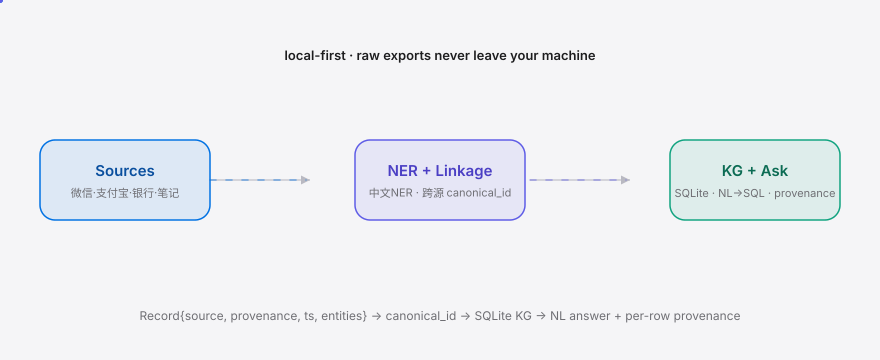

**English** | [简体中文](./README.md)

<div align="right"><sub><b>EN</b>&nbsp;&nbsp;⇄&nbsp;&nbsp;<a href="./README.md">中文</a></sub></div>

<picture>
  <source media="(prefers-color-scheme: dark)" srcset="./assets/hero-dark.svg">
  <source media="(prefers-color-scheme: light)" srcset="./assets/hero-light.svg">
  
</picture>

<p align="center"><sub>MineKG fuses your 微信 / 支付宝 / bank-statement / notes exports into one local-first, natural-language-queryable knowledge graph.</sub></p>

<p align="center">
  <a href="./LICENSE"></a>
  <a href="https://github.com/SuperMarioYL/minekg/releases"></a>
  <a href="https://github.com/SuperMarioYL/minekg/actions/workflows/ci.yml"></a>
  
  
  
  
</p>

> **Recognize the "小张" scattered across your WeChat, Alipay, bank statements and notes as one person — then ask your data a single question.**

## Why now

[Graphify-Labs/graphify](https://github.com/Graphify-Labs/graphify) (103k stars) proved the primitive: turn a codebase into a queryable knowledge graph with deterministic AST parsing, no vector store, every edge explained — shipped as a `/graphify` **Skill** for **Claude Code** and Cursor. MineKG is an isomorphic transfer of that "structured-data → queryable KG" primitive from codebases to a Chinese ordinary user's scattered personal-data exports. Chinese NER (person/place/org/time) is now commodity, and PIPL pushed 微信/支付宝/银行 to (grudgingly) offer exports — the three enablers are simultaneously in place for the first time, so the consumer surface is finally reachable. It is not "graphify in Chinese"; the load-bearing novelty is **cross-source entity-linkage** — the natural-language RAG layer runs on a KG you own, with every row traceable to a source.

## Table of contents

- [Architecture](#architecture)
- [Install & quickstart](#install--quickstart)
- [Usage](#usage)
- [Demo](#demo)
- [Configuration](#configuration)
- [Roadmap](#roadmap)
- [Paid: household / team reconciliation hosting](#paid-household--team-reconciliation-hosting)
- [License](#license)

<h2> Architecture</h2>

<picture>
  <source media="(prefers-color-scheme: dark)" srcset="./assets/atlas-dark.svg">
  <source media="(prefers-color-scheme: light)" srcset="./assets/atlas-light.svg">
  
</picture>

One Python process, one SQLite file (`~/.minekg/minekg.db`). No microservices, no vector store (deterministic KG, mirroring graphify's "no vector store" stance). Only short text snippets are sent to qwen for NER — **raw export files never leave your machine**, a hard requirement for anything touching personal bills/statements.

The load-bearing primitive is **cross-source `canonical_id` resolution**: the WeChat display name "小张", the Alipay remark "张三" and the bank statement "张\*" collapse into a single node.

<h2> Install & quickstart</h2>

```bash
git clone https://github.com/SuperMarioYL/minekg && cd minekg && pip install -e .
minekg ingest examples/exports && minekg link
minekg ask "去年和小张相关的所有资金往来合计"
```

> Works without a DashScope key — NER / linkage / NL→SQL fall back to a deterministic rule path, so the 10-minute demo reproduces offline.

<details><summary>Sample output</summary>

```
$ minekg ask "去年和小张相关的所有资金往来合计"
Q: 去年和小张相关的所有资金往来合计
A: 500.00 元
entity: person:张三  (matched: 小张)
provenance:
  alipay  examples/exports/alipay.csv  line 5   2025-01-10  张三  200.0  person:张三
  alipay  examples/exports/alipay.csv  line 6   2025-03-15  张三  300.0  person:张三
```

</details>

<h2> Usage</h2>

Five subcommands cover the full path from export to answer:

```bash
# 1. Optional: configure a DashScope (qwen) key for sharper Chinese NER/linkage
minekg config --dashscope-key sk-***

# 2. Drop export files in one dir; sources are auto-detected by content
minekg ingest ./exports        # alipay.csv + bank.pdf + wechat.txt + notes.md → unified Record JSONL

# 3. Chinese NER + cross-source canonical_id resolution + SQLite KG + ambiguity report
minekg link                    # WeChat "小张" ≈ Alipay "张三" ≈ bank "张*"

# 4. Natural-language question → number + per-row provenance table
minekg ask "和小张相关的所有资金往来合计"
minekg ask "去年和小张吃了几次饭"        # count intent
minekg ask "2025 年和小张相关的支出平均"

# 5. (later milestone) confirm/merge flagged entity pairs
minekg resolve
```

Adapter details:

| Source | File | Parsing |
|---|---|---|
| WeChat | `.txt` | timestamp+speaker block parsing, reassembles multi-line messages |
| Alipay | `.csv` | auto-locates the header row (tolerant to column-name variants), GBK/UTF-8-BOM auto-detected |
| Bank | `.pdf` | `pdfplumber` text-line parsing, reassembles multi-line counter-party info, **full names kept (not masked)** |
| Notes | `.md` | one record per line, extracts dates; entities left to NER |

> Bank-statement note (schema-verified on a real 招商银行 PDF): `pdfplumber.extract_tables()` returns 0 tables, so the adapter parses text lines and reassembles the wrapping 对手信息 column; counter-party names are full, not masked. `parse_lines` holds the core logic; `parse_pdf` is a thin pdfplumber wrapper.

<h2> Demo</h2>


10 minutes from `git clone` to a receipt-backed answer. The GIF above is rendered from [`docs/demo.tape`](./docs/demo.tape) via vhs (`assets/demo.gif` is committed as-is; `demo.yml` only refreshes it on demand).

### vs graphify

| Axis | [graphify](https://github.com/Graphify-Labs/graphify) | MineKG |
|---|:---:|:---:|
| Input data | codebases (AST/SQL schema) | Chinese consumer exports (WeChat/Alipay/bank/notes) |
| Chinese NER (person/place/org/time) | — | ✓ |
| Cross-source entity-linkage (canonical_id) | — | ✓ |
| Codebase→KG maturity & scale | ✓ (103k stars, mature) | partial (new, m1) |
| No vector store / every edge explained | ✓ | ✓ |

Honestly: on codebases graphify is far more mature and faster than we are; MineKG's value is the surface it does not touch — heterogeneous Chinese personal exports + Chinese NER + cross-source linkage, run as a local-first RAG.

<h2> Configuration</h2>

| Key / env | Type | Default | Meaning |
|---|---|---|---|
| `minekg config --dashscope-key` | str | none | DashScope (qwen) API key; if unset, the rule fallback is used |
| `MINEKG_HOME` | path | `~/.minekg` | work dir (records.jsonl / minekg.db / config.json); override for tests/demo |
| DashScope endpoint | str | `https://dashscope.aliyuncs.com/compatible-mode/v1` | OpenAI-compatible endpoint; only short text snippets are sent |

<h2> Roadmap</h2>

- [x] **m1**: four source adapters → unified Record JSONL (with provenance) + NER + cross-source linkage + SQLite KG + NL query, end-to-end
- [ ] **m2**: full qwen NER/linkage quality pass + ambiguity recall; linkage report exportable / re-runnable
- [ ] **m3**: `minekg resolve` rich TUI to confirm/merge flagged entity pairs; a multi-bank PDF parser registry (community can contribute "one bank = one parser")
- [ ] Future: more sources (brokerage / 公积金), one-shot annual-review reports, a local-first household/team reconciliation hosting tier

## Paid: household / team reconciliation hosting

For the **commercial audience**. The local CLI is free forever, locally owned, single-user — the trust prerequisite for a tool that touches personal bills/statements. The paid direction is the named, explicitly-not-built-now **hosting tier**:

- **Who pays first**: small teams / households that need cross-member reconciliation — a founder merging "personal WeChat + company Alipay + bank statements" for annual tax/review, or a household merging spouses' exports into one queryable family ledger.
- **What they pay for**: a hosting tier — the minekg core runs in the cloud, members upload their own exports, merged into one household/team KG with role-scoped views (each spouse sees their own, the household sees the total). The local CLI stays free; the host is priced per team.
- **Price point**: ¥39/month per team (3-5 members, includes a monthly qwen quota), overage metered. CN consumer SaaS sits in the ¥19-49/month band.
- **Minimal "give me a credit card" path**: CLI runs the 10-minute demo (free) → a README "sync to a cloud family ledger" button → invite 2 members to upload exports → merged KG + role views → answer "who paid what last month in our family". The card is charged only at the moment the merged result is shown.

See GTM §8. Local-first is the floor; hosting is opt-in and never replaces the local CLI.

<h2> License</h2>

MIT — see [LICENSE](./LICENSE). File a bug or attach an anonymized real multi-source export in [Issues](https://github.com/SuperMarioYL/minekg/issues); PRs via Fork → branch → PR.

## Share this

```
MineKG — fuse WeChat/Alipay/bank/notes exports into one local-first, NL-queryable KG. The Skill primitive from graphify, applied to a Chinese user's scattered personal data. 10 minutes from clone to "how much did I pay 小张 last year — 500元, with receipts." https://github.com/SuperMarioYL/minekg
```

<p align="center"><sub><a href="./LICENSE">MIT</a> © 2026 SuperMarioYL</sub></p>
