[English](README.en.md) | **简体中文**

<picture>
  <source media="(max-width: 640px) and (prefers-color-scheme: dark)" srcset="assets/presentation/hero-mobile-dark.svg">
  <source media="(max-width: 640px)" srcset="assets/presentation/hero-mobile-light.svg">
  <source media="(prefers-color-scheme: dark)" srcset="assets/presentation/hero-dark.svg">
  
</picture>

**MineKG 将微信文本、支付宝 CSV、特定银行 PDF 和笔记导出整理到 SQLite，建立实体别名关联，并为简单查询返回原始行来源。**

`Python 3.10+` · [MIT](LICENSE) · [GitHub](https://github.com/SuperMarioYL/minekg) · [网站](https://minekg.lei6393.com)

## 为什么需要它

同一个人在不同导出中可能使用昵称、全名或掩码姓名，按单份文件检索容易漏掉相关记录。MineKG 将来源记录与别名放进同一张图，再把查询结果连回文件和行号。姓名归并是候选推断，歧义仍需人工检查。

<picture>
  <source media="(max-width: 640px) and (prefers-color-scheme: dark)" srcset="assets/presentation/process-mobile-dark.svg">
  <source media="(max-width: 640px)" srcset="assets/presentation/process-mobile-light.svg">
  <source media="(prefers-color-scheme: dark)" srcset="assets/presentation/process-dark.svg">
  
</picture>

## 架构

来源 adapter 产生统一 Record 与 provenance，NER 提取实体，linkage 生成 canonical_id、别名和歧义列表。kg.py 保存 records/entities/aliases 及边；ask.py 根据规则解析人物、时间和 sum/count/avg 意图，再读取关联记录。当前 ask 的 client 参数没有驱动模型生成 SQL。

<picture>
  <source media="(max-width: 640px) and (prefers-color-scheme: dark)" srcset="assets/presentation/architecture-mobile-dark.svg">
  <source media="(max-width: 640px)" srcset="assets/presentation/architecture-mobile-light.svg">
  <source media="(prefers-color-scheme: dark)" srcset="assets/presentation/architecture-dark.svg">
  
</picture>

## 安装

需要 Python 3.10+。安装可能联网；自清理示例显式使用规则路径，不读取用户的 MineKG 数据目录或模型配置。

```bash
git clone https://github.com/SuperMarioYL/minekg.git
cd minekg
python3 -m venv .venv
source .venv/bin/activate
python -m pip install -e .
```

## 快速开始

```bash
python examples/presentation_demo.py
```

仓库三种构造导出产生 11 条记录。规则将“小张”关联到 person:张三，2025 年查询返回 500.00 元，来源是 200 与 300 两条金额记录，同时保留 1 个歧义报告。该合计把金额字段相加，不是把收入与支出相抵后的净额。

## 用法

```bash
# 用单独目录保存此份样例的状态
export MINEKG_HOME="$PWD/.minekg-example"
minekg ingest examples/exports
minekg link
minekg ask "2025 年和小张相关的资金往来合计"
minekg ask "2025 年和小张相关的记录有多少条"
```

link 会重建目标 SQLite 图谱；不要把导入过程误当增量合并已有独立数据库。resolve 目前只打印后续功能提示，不能在 CLI 中完成手动身份确认。

## 能力与集成

| 来源 | 实现路径 |
|---|---|
| 微信 TXT | 时间戳/发送者消息块 |
| 支付宝 CSV | 表头与编码适配 |
| 银行 PDF | pdfplumber 文本行解析；需匹配格式 |
| Markdown 笔记 | 逐行记录及日期提取 |
| SQLite | 查询、别名与行级来源 |

<picture>
  <source media="(max-width: 640px) and (prefers-color-scheme: dark)" srcset="assets/presentation/integrations-mobile-dark.svg">
  <source media="(max-width: 640px)" srcset="assets/presentation/integrations-mobile-light.svg">
  <source media="(prefers-color-scheme: dark)" srcset="assets/presentation/integrations-dark.svg">
  
</picture>

## 配置与边界

MINEKG_HOME 默认 ~/.minekg，包含 records.jsonl、minekg.db 和 config.json。未配置 DashScope key 时使用规则抽取和链接；配置后 NER 和歧义处理可能发送记录片段至服务，这些片段也可能包含个人信息，不能说数据完全不出机。

简单问答只支持当前的人名/时间/聚合规则，不解释任意自然语言，也不完整处理“收入/支出”过滤语义。别名规则可能把同姓人物关联；有 provenance 不等于身份或会计口径正确。不同银行导出和加密/扫描 PDF 应单独验证。

## 运行记录

v0.1.0 的真实规则导入、链接和 SQLite 查询。没有真实个人数据、模型请求或银行 PDF 解析验收；临时数据库结束后删除。

[输入、命令和完整输出](docs/demo-results.json)

[保留的历史终端录屏](assets/demo.gif) · [录制脚本](docs/demo.tape)。本轮示例以以上可重放记录为准。

## 路线图

- [x] 多种导出适配、规则/可选模型实体处理。
- [x] SQLite 关联与简单查询、逐行来源。
- [x] 歧义报告。
- [ ] 交互式 resolve 与更多银行解析器。
- [ ] 更完善的链接质量与查询语义。

当前没有家庭/团队托管账本或付费同步服务。

## 开发与许可证

```bash
python -m pip install pytest
python -m pytest
```

统一格式见 minekg/__init__.py；新增来源 adapter 时保留文件与行号。

[MIT](LICENSE) · [Issues](https://github.com/SuperMarioYL/minekg/issues)
